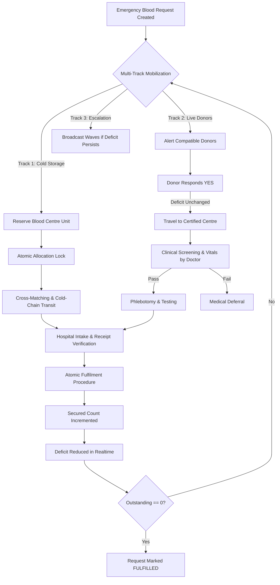

# 📐 RAKTSETU System Architecture Document

## 1. Architectural Philosophy
RAKTSETU is engineered from first principles around the foundational insight:
$$\text{Required} - \text{Secured} = \text{Outstanding}$$

In traditional blood donation platforms, user responses ("I can donate") are conflated with supply. In clinical healthcare, an unverified intention cannot transfuse a patient suffering from hemorrhagic shock.

RAKTSETU strictly segregates **Mobilization** (human intent) from **Fulfilment** (physical verified units).



---

## 2. Core Subsystems

### 2.1 Real-Time Synchronization Engine
- Employs **Supabase Realtime PostgreSQL Change Data Capture (CDC)** over WebSockets.
- Listens to `INSERT`, `UPDATE`, and `DELETE` on all 11 core tables (`blood_requests`, `donor_journeys`, `blood_units`, `fulfilment_records`, `audit_logs`, etc.).
- Eliminates manual polling or optimistic client-only UI updates; frontend states are direct reflections of PostgreSQL commits.

### 2.2 Independent State Machines
The system executes two decoupled state machines:

#### A. Donor Journey Pipeline
1. `MATCHED`: Candidate donor identified based on blood group compatibility and cooling period.
2. `ALERTED`: Notification dispatched to donor device.
3. `RESPONDED_YES`: Donor accepts alert. **Deficit remains unchanged**.
4. `TRAVELING`: Donor in transit to the blood bank or collection facility.
5. `AT_CENTRE`: Donor checked in at the physical site.
6. `SCREENING`: Clinical screening (vitals, Hb, travel/medication history) underway by medical officer.
7. `ELIGIBLE`: Doctor certifies donor as fit.
8. `DONATED`: Phlebotomy complete. Unit transferred to testing/processing.
*(Alternative paths: `RESPONDED_NO`, `NO_RESPONSE`, `CANCELLED`, `DEFERRED`)*.

### 2.3 WhatsApp Donor Mobilization Subsystem
RAKTSETU supports two synchronized WhatsApp mobilization paths:

1. **One-Click Clinical Outreach (Deep-Link Integration)**:
   - Hospital coordinators can trigger instant outreach via WhatsApp Web / Mobile using `RealBackendService.generateWhatsAppAlertUrl(...)`.
   - Generates pre-formatted emergency templates including hospital name, blood group, outstanding deficit, location, and personalized response links.

2. **Automated WhatsApp Business Cloud API & Webhooks**:
   - Integrated with Meta WhatsApp Cloud API / Twilio WhatsApp API via Supabase Edge Functions.
   - When an emergency request is logged, an interactive template message with Quick Reply buttons (`[I CAN DONATE NOW]`, `[UNAVAILABLE]`) is sent to verified compatible donors.
   - Inbound webhook handler maps donor responses directly to `donor_journeys.status = 'RESPONDED'` in PostgreSQL.
   - **Crucial Rule**: Donor's WhatsApp response does *not* reduce outstanding deficit until clinical intake and screening are completed.

#### B. Cold-Chain Blood Unit Pipeline
1. `AVAILABLE`: Unit stored under monitored temperature (2°C - 6°C for PRBC, -20°C for FFP).
2. `RESERVED`: Unit tentatively earmarked for an active emergency.
3. `ALLOCATED`: Unit locked against concurrent requests via row lock.
4. `PACKED`: Verified and packed in temperature-controlled transport container.
5. `DISPATCHED`: En route to the requesting hospital.
6. `DELIVERED`: Physically arrived at requesting facility blood bank.
7. `CROSSMATCHED`: Serological crossmatch confirmed compatible with recipient.
8. `TRANSFUSED`: Administered to the patient.

---

## 3. High-Concurrency & Race-Condition Protections

### Stored Procedure: `allocate_blood_unit_atomic`
In high-stress mass casualty scenarios, multiple hospital coordinators may attempt to claim the same rare unit (e.g., O-Negative).
RAKTSETU executes:
```sql
SELECT * FROM blood_units
WHERE id = p_unit_id
FOR UPDATE; -- Explicit Row-Level Concurrency Lock
```
If `status != 'AVAILABLE'`, the transaction throws a standard PostgreSQL exception: `Unit is not available for allocation`.

### Stored Procedure: `confirm_fulfilment_atomic`
When confirming a unit:
1. Validates operator role (`HOSPITAL_ADMIN`, `HOSPITAL_COORDINATOR`, `BLOOD_CENTRE_ADMIN`).
2. Locks the `blood_requests` row with `FOR UPDATE`.
3. Verifies that `outstanding_units > 0`.
4. Inserts an immutable `fulfilment_records` verification entry.
5. Updates `secured_units = secured_units + 1`.
6. PostgreSQL trigger recalculates `outstanding_units = GREATEST(required_units - secured_units, 0)`.
7. Automatically transitions status to `FULFILLED` if `outstanding_units == 0`.
8. Records an immutable cryptographic hash entry in `audit_logs`.

---

## 4. Disaster Recovery & Offline Readiness
- Real-time client maintains local caching with transparent reconnection over WebSocket drops.
- PostgreSQL schema enforces consistency constraints at the database engine level, rendering unauthorized or malformed client-side requests harmless.
